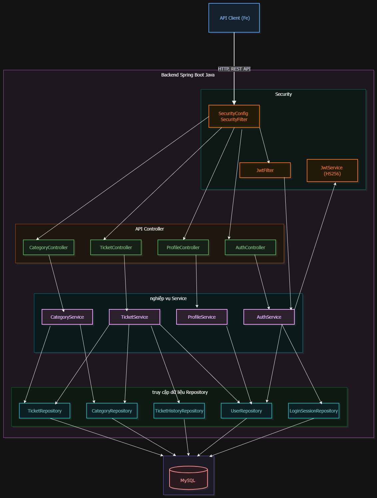
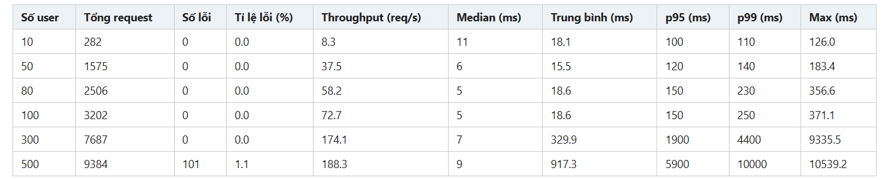
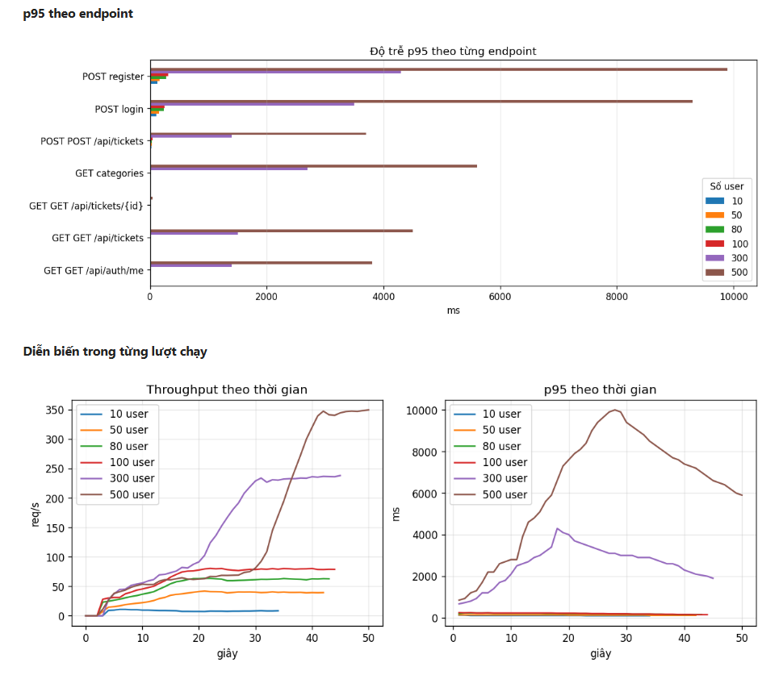
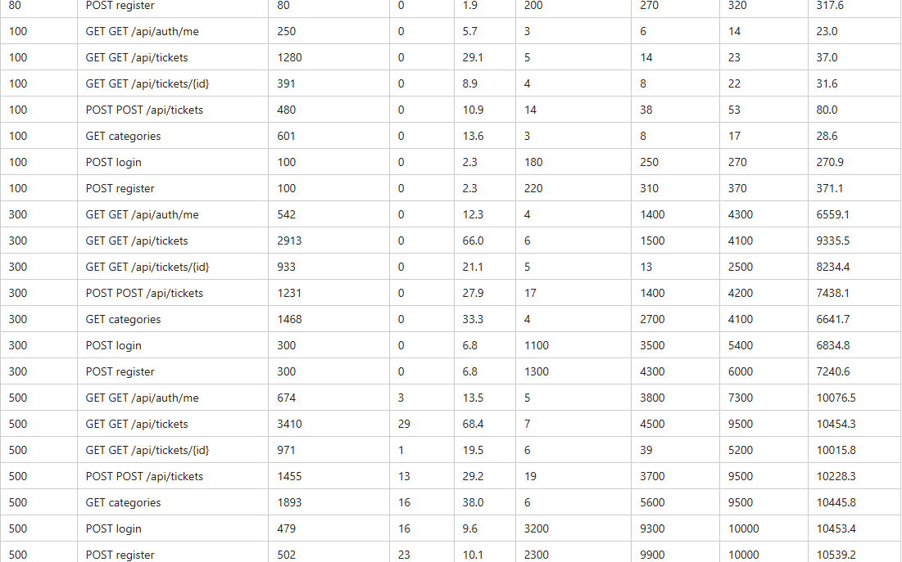
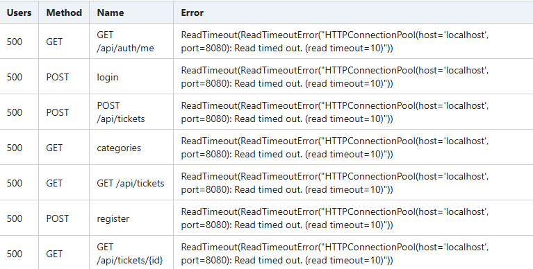

# IT-Helpdesk-Portal
IT Support: Hệ thống gửi và xử lý yêu cầu hỗ trợ sửa chữa IT <br>
(Bài tập lớn Phase 1 KTPM năm học 2026 - 2027, Nhóm 3 - Ca 3) <br>
Thành viên:  
| Thành viên | Mã sinh viên |
| :---- | :---- |
| Đặng Hoàng Sơn | 23021680  |
| Cao Vũ Nhật Triều | 23021740 |
| Trần Trung Hậu | 23020061 |
| Phan Bá Thọ | 23020163 |

## Tổng quan Bài toán
* **Helpdesk Management System - IT Support** là một hệ thống quản lý và xử lý yêu cầu hỗ trợ (support ticket) giữa người dùng và bộ phận hỗ trợ kỹ thuật. Hệ thống cho phép người dùng tạo các yêu cầu hỗ trợ, theo dõi tiến trình xử lý, trao đổi thông tin với nhân viên hỗ trợ, trong khi quản trị viên có thể quản lý người dùng, phân công ticket, theo dõi trạng thái và đánh giá hiệu quả xử lý.
* **Mục tiêu:** quản lý yêu cầu hỗ trợ IT từ lúc tiếp nhận, phân công, xử lý đến khi đóng ticket, có lưu vết toàn bộ thay đổi.  
* **Vai trò:** User tạo và theo dõi ticket của mình. Agent xử lý ticket được giao. Admin phân công quản lý. 
* **Dữ liệu chính:** tài khoản và vai trò, phiên đăng nhập, danh mục, ticket, bình luận, tệp đính kèm, lịch sử ticket, thông báo.

## Nghiệp vụ chính

* **Tạo ticket:** User đăng nhập, tạo ticket với tiêu đề, mô tả, danh mục và mức ưu tiên, sau đó có thể tải tệp minh chứng.  
* **Xử lý:** Agent chuyển ticket sang IN\_PROGRESS, trao đổi với User qua bình luận, xong thì chuyển RESOLVED.  
* **Đóng hoặc mở lại:** User xác nhận và đóng ticket RESOLVED. Agent hoặc Admin cũng có thể đóng. Nếu chưa xong, ticket được chuyển lại IN\_PROGRESS.  
* **Luồng trạng thái:** NEW → IN\_PROGRESS → RESOLVED → CLOSED, cho phép RESOLVED → IN\_PROGRESS. CLOSED là trạng thái cuối, không bình luận được nữa.  
* **Lưu vết:** các thao tác tạo, sửa, đổi trạng thái, gán và bình luận đều ghi lịch sử. Gán nhận thông báo trong ứng dụng khi có thay đổi.

## Công nghệ - Phạm vi

| Thành phần | Công nghệ |
| :---- | :---- |
| Ngôn ngữ, framework | Spring Boot 3 Java 21 |
| Cơ sở dữ liệu | Spring Data JPA, MySQL 8 |
| REST API | dùng JSON |
| Xác thực | JWT - Access Token, Refresh Token |
| Đóng gói | Chạy bằng Docker Compose. Không có giao diện người dùng. |

## Danh sách tóm tắt API Endpoints

| Method | Endpoint | Quyền |
| :---- | :---- | :---- |
| **POST** | /api/auth/register | Công khai |
| **POST** | /api/auth/login | Công khai | 
| **POST** | /api/auth/refresh-token | Công khai | 
| **POST** | /api/auth/logout | Đã đăng nhập | 
| **GET** | /api/auth/me | Đã đăng nhập | Không có |
| **PUT** | /api/users/profile | Đã đăng nhập | 
| **POST** | /api/tickets | Đã đăng nhập | 
| **GET** | /api/tickets | Đã đăng nhập; User chỉ thấy ticket của mình | 
| **GET** | /api/tickets/{id} | Xem ticket | 
| **PUT, PATCH** | /api/tickets/{id} | User khi ticket NEW; Agent được gán; Admin | 
| **PATCH** | /api/tickets/{id}/status | User chỉ đóng ticket RESOLVED; Agent được gán; Admin |
| **PATCH** | /api/tickets/{id}/assign | Admin |
| **DELETE** | /api/tickets/{id} | User khi ticket NEW; Admin |
| **GET** | /api/tickets/{id}/history | Xem ticket |  
| **GET** | /api/categories | Công khai |
| **POST** | /api/categories | Admin | 
| **PUT, PATCH** | /api/categories/{id} | Admin | 
| **DELETE** | /api/categories/{id} | Admin |  

## Kiến trúc tổng quan
* Kiến trúc phân tầng cho backend Spring Boot, kết hợp REST API xử lý yêu cầu, Spring Data JPA truy cập MySQL-JWT xác thực, Docker Compose triển khai. 



```text
Client
  |
  | HTTP, REST, JSON
  v
Spring Security
  |-- JWT: Xác thực người dùng
  |-- Session: Quản lý trạng thái đăng nhập
  |-- Phân quyền truy cập
  |
  v
API, Controller
  |-- Auth
  |-- Ticket
  |-- Category
  |-- Tiếp nhận request, kiểm tra dữ liệu đầu vào
  |
  v
Service
  |-- Xử lý nghiệp vụ
  |-- Phân công ticket
  |-- Quản lý trạng thái và lịch sử
  |-- Kiểm tra quyền
  |
  v
Repository
  |-- Spring Data JPA
  |-- Truy vấn và lưu dữ liệu
  |
  v
Model (Entity)
  |-- Biểu diễn đối tượng nghiệp vụ
  |-- Ánh xạ đối tượng với bảng dữ liệu bằng JPA
  |
  v
MySQL 8
  `-- Lưu trữ dữ liệu
```

* Thư mục

```text
IT-Helpdesk-Portal/
├── .github/
│   └── workflows/
│       └── ci.yml                  # GitHub Actions: test, build và publish Docker image
│
├── .idea/                          # Cấu hình IDE
│
├── backend/
│   ├── src/
│   │   └── main/
│   │       └── java/
│   │           └── com/example/backend/
│   │               ├── BackendApplication.java
│   │               ├── api/        # REST API: Auth, Ticket, Category
│   │               ├── config/     # Cấu hình Spring Security
│   │               ├── security/   # JWT, authentication filter, xử lý mật khẩu
│   │               ├── service/    # Xử lý nghiệp vụ
│   │               ├── repository/ # Truy cập dữ liệu bằng Spring Data JPA
│   │               └── model/      # Entity, enum và đối tượng dữ liệu
│   │
│   ├── pom.xml                     # Thư viện và cấu hình Maven
│   ├── mvnw                        # Maven Wrapper
│   ├── Dockerfile                  # Đóng gói ứng dụng thành Docker image
│   └── .dockerignore               # Các tệp loại trừ khi build image
│
├── helpdesk_mysql.sql              # Khai báo cấu trúc cơ sở dữ liệu
├── docker-compose.yaml             # Khởi chạy Backend và MySQL
└── README.md                       # Tài liệu dự án, nghiệp vụ và API
```


## Cơ sở dữ liệu


- app_users: Tài khoản người dùng, với role là 1 thuộc User, Admin, Agent.
- login_sessions: Phiên đăng nhập, 1 id người dùng có thể có nhiều phiên đăng nhập cùng trên các thiết bị khác nhau.
- tickets: Lưu mỗi yêu cầu (1 ticket) của người dùng lên hệ thống IT Support với các thông tin đi kèm (tình trạng, ngày, mô tả...), và lịch sử ticket, phân loại.
- tickets_history: Lưu lịch sử (các lần xử lý yêu cầu) của mỗi ticket. Categories phân loại ticket.

## Yêu cầu khác
* Xác thực: access token JWT sống 15 phút, refresh token và được xoay vòng mỗi lần làm mới. Logout thu hồi phiên nên access token cũ cũng bị từ chối. <br>
* Phân quyền: theo vai trò và chủ sở hữu. Bình luận, lịch sử và tệp dùng chung quyền xem với ticket. Agent không được xóa ticket. <br>
* Giá trị hợp lệ: priority gồm LOW, MEDIUM, HIGH, URGENT, mặc định MEDIUM. Status gồm NEW, IN_PROGRESS, RESOLVED, CLOSED. <br>
* Transaction: thay đổi ticket, ghi lịch sử và tạo thông báo nằm trong cùng một transaction. <br>
* Cấu hình: chuỗi kết nối DB, JWT secret, thư mục upload và tài khoản Admin đầu tiên lấy từ biến môi trường. Danh mục mẫu được tạo khi khởi động. 

## Kiểm thử Tải Kaggle

* Các kết quả sau chạy đo đạc thu được: <br>



<br>

* Lỗi xuất hiện khi users đồng thời là 500: <br>



<br>

Chạy tại: https://www.kaggle.com/code/cvntriu/stresstest2 


## Luồng CI đóng gói docker iamge và đẩy lên container registry của github

Luồng: push code lên `main` → Maven `clean verify` → build JAR → Docker build → push GHCR. (file CI.yml trong folder .github)

Config gồm:
- `maven` : Build jar từ app
- `backend/Dockerfile`: đóng JAR đã build vào image có Java 21 JRE.
- `backend/.dockerignore`: chỉ gửi JAR vào Docker build context.
- `.github/workflows/ci.yml`: build và publish tự động bằng GitHub Actions.
  
** `docker-compose.yaml`: sẽ pull image từ ghcr về kèm với image mysql, ko liên quan đến luồng CI.

### Đưa cấu hình lên GitHub
cd vào thư mục repository
```powershell
git add .github/workflows/ci.yml backend/Dockerfile backend/.dockerignore docker-compose.yaml README.md
git commit -m "Add Docker packaging and GHCR CI"
git push origin main
```

Khi thành công, package được liên kết với repository và có image:

```text
ghcr.io/sondank1010/it-helpdesk-portal:latest
ghcr.io/sondank1010/it-helpdesk-portal:sha-<full-commit-sha>
```
### Pull về chạy compose không cần môi trường + mysql-server:
cd vào thư mục -> docker compose up -d -> chạy file compose.yml

## Đề xuất Phase 2


| Vấn đề | Đề xuất giải pháp |
| :---- | :---- |
| **Chịu tải:** Hệ thống IT Helpdesk Portal đang chỉ hoạt động tốt ở mức tải rất thấp (10-100 users) nhưng bắt đầu quá tải và suy giảm hiệu năng rõ rệt ở các mức users cao hơn (500 users thì có 101 / 9384 request Timeout - Locust không nhận được phản hồi trong vòng 10s, xem danh mục và xác thực cũng bị chậm).<br><br>**Nguyên nhân:**<br>* Truy vấn database mọi request xác thực: JwtFilter gọi AuthService.authenticate() cho mỗi request có Bearer token, AuthService.java lại truy vấn bằng login_sessions để kiểm tra phiên đăng nhập. Khi tải tăng đây là điểm tranh chấp connection.<br>* TicketService.create() phát sinh nhiều thao tác ghi (lưu ticket, history), TicketRepository.searchPage() dùng nhiều điều kiện lọc tuỳ chọn (is null or) kết hợp phân trang - vừa lấy dữ liệu vừa Count và giảm khả năng tận dụng index, giảm hiệu năng.<br>* application.yaml chưa khai báo maximum-pool-size, đang tự chạy mặc định.<br>* history() trả toàn bộ lịch sử trong một List, không phân trang. | * Cache thông tin session bằng Redis hoặc tối ưu cơ chế auth để giảm truy vấn MySQL.<br>* Tối ưu transaction, truy vấn động và index bộ lọc thực tế, dùng EXPLAIN cho query danh sách và count, hạn chế N+1 query. |
| Chưa giới hạn số lần đăng nhập, đăng ký: Chưa rate limiting cho các endpoint /auth/login và /register. | Giới hạn request theo tài khoản. |
| LoginSessionRepository chưa có cơ chế dọn dẹp xoá session hết hạn hoặc bị thu hồi, ProfileService.update() chỉ cập nhật password. | Job định kỳ xoá session hết hạn, revoked hoặc đổi mật khẩu; giới hạn số session đồng thời mỗi tài khoản; thêm index cho expired_at và revoked. |
| Race Condition: <br>* AuthService kiểm tra existsByEmail() trước khi insert, 2 request đăng ký cùng một email đồng thời có thể cùng vượt qua bước kiểm tra. <br>* Ticket Entity chưa có @Version để kiểm soát xung đột cập nhật. | <br>* unique constraint trong database. <br>* Bổ sung optimistic locking và trả HTTP 409 khi xảy xung đột.|
| dock-compose.yaml chỉ chạy 1 app container (backend) và 1 MySQL container, toàn bộ tải tập trung vào 1 JVM và 1 MySQL instance trên máy Docker Desktop. | load balancer / resource limit, app healthcheck và migration database để thay đổi SQL khi volume đã tồn tại.|

